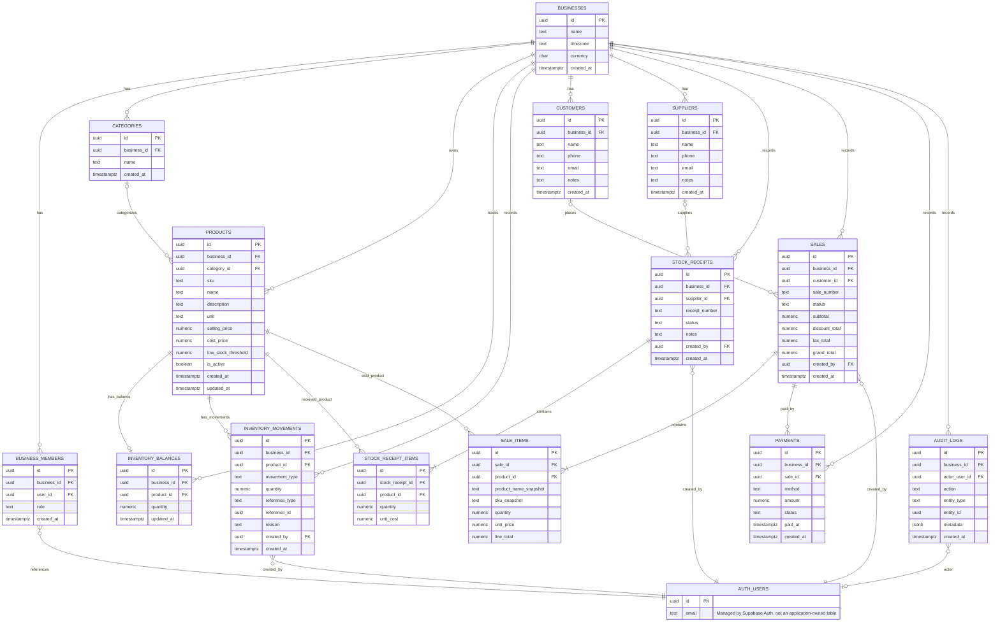

# ERD — Inventory & Sales Management

- **Versi:** 1.0
- **Status:** Draft untuk MVP
- **Tech stack:** TanStack Start, Drizzle ORM, Supabase PostgreSQL + Auth
- **Tanggal:** 2 November 2026

## 1. Entity Relationship Diagram

Diagram ini menggunakan Mermaid ERD. Diagram dapat dirender di GitHub, GitLab, VS Code dengan ekstensi Mermaid, atau Mermaid Live Editor.



## 2. Ringkasan Relasi

| Relasi                                   | Kardinalitas | Penjelasan                                                                            |
| ---------------------------------------- | ------------ | ------------------------------------------------------------------------------------- |
| `businesses` → `business_members`        | 1:N          | Satu bisnis memiliki banyak anggota                                                   |
| `businesses` → `products`                | 1:N          | Produk dimiliki oleh satu bisnis                                                      |
| `categories` → `products`                | 1:N          | Kategori dapat memiliki banyak produk; kategori produk boleh kosong                   |
| `products` → `inventory_balances`        | 1:0..1       | Setiap produk memiliki maksimal satu saldo stok                                       |
| `products` → `inventory_movements`       | 1:N          | Setiap produk memiliki riwayat perubahan stok                                         |
| `suppliers` → `stock_receipts`           | 1:N          | Pemasok dapat terkait dengan banyak penerimaan barang                                 |
| `stock_receipts` → `stock_receipt_items` | 1:N          | Satu penerimaan berisi satu atau lebih item                                           |
| `customers` → `sales`                    | 1:N          | Pelanggan dapat memiliki banyak transaksi; pelanggan pada transaksi bersifat opsional |
| `sales` → `sale_items`                   | 1:N          | Satu transaksi berisi satu atau lebih item                                            |
| `sales` → `payments`                     | 1:N          | Mendukung satu atau beberapa catatan pembayaran                                       |
| `auth.users` → `business_members`        | 1:N          | Pengguna Supabase dapat menjadi anggota beberapa bisnis                               |
| `auth.users` → catatan operasional       | 1:N          | Menyimpan siapa yang membuat pergerakan stok, penerimaan, penjualan, atau audit       |

## 3. Aturan Integritas yang Wajib

### 3.1 Constraint dan indeks

Implementasikan constraint berikut melalui Drizzle schema dan/atau migration SQL:

- Primary key UUID untuk setiap entitas.
- Foreign key untuk seluruh relasi yang didefinisikan.
- `UNIQUE (business_id, user_id)` pada `business_members`.
- `UNIQUE (business_id, sku)` pada `products`.
- `UNIQUE (business_id, sale_number)` pada `sales`.
- `UNIQUE (business_id, receipt_number)` pada `stock_receipts`.
- `UNIQUE (business_id, product_id)` pada `inventory_balances`.
- `CHECK (selling_price >= 0)` pada `products`.
- `CHECK (quantity > 0)` untuk item penjualan, item penerimaan, dan kuantitas pergerakan.
- `CHECK (amount >= 0)` untuk pembayaran.
- Indeks pada `business_id`, foreign key, `created_at`, status transaksi, serta kolom yang sering digunakan untuk pencarian dan filter.

Validasi lintas tabel—misalnya memastikan `product_id` dan `business_id` berasal dari bisnis yang sama—perlu ditegakkan dengan desain foreign key yang sesuai, constraint tambahan, atau fungsi database tepercaya. Jangan mengandalkan validasi UI saja.

### 3.2 Isolasi multi-tenant

- Tabel data bisnis harus menyimpan `business_id`.
- Terapkan RLS pada seluruh tabel yang dapat diakses melalui Supabase API.
- Kebijakan RLS harus memverifikasi keanggotaan pengguna pada bisnis terkait.
- Operasi server menggunakan Drizzle tetap harus memeriksa otorisasi.
- Jika koneksi Drizzle menggunakan kredensial berhak istimewa yang melewati RLS, jangan menganggap RLS otomatis melindungi operasi tersebut. Validasi keanggotaan di server atau gunakan koneksi/strategi yang mempertahankan konteks pengguna.
- Jangan mengekspos `service_role` key atau kredensial database ke browser.

### 3.3 Konsistensi inventaris

`inventory_balances.quantity` adalah saldo terkini untuk pembacaan cepat, sedangkan `inventory_movements` adalah jejak perubahan stok.

Semua operasi yang mengubah stok harus:

1. Memvalidasi pengguna, peran, bisnis, produk, dan kuantitas.
2. Mengunci atau memperbarui saldo secara atomik.
3. Memastikan stok mencukupi jika stok negatif tidak diperbolehkan.
4. Memperbarui saldo dan membuat movement dalam satu transaksi database.
5. Membatalkan seluruh transaksi jika salah satu langkah gagal.

Jangan izinkan aplikasi mengubah `inventory_balances.quantity` secara langsung tanpa movement yang sesuai. Untuk audit yang lebih kuat, saldo dapat direkonsiliasi secara berkala dengan menjumlahkan seluruh pergerakan.

### 3.4 Konsistensi penjualan

Operasi `completeSale` harus menyimpan header penjualan, item, pembayaran, dan inventory movements dalam satu transaksi database. Harga dan total dihitung ulang di server. Simpan snapshot nama produk, SKU, dan harga agar riwayat transaksi tidak berubah saat data produk diperbarui.

Gunakan idempotency key atau mekanisme deduplikasi agar retry request tidak menghasilkan transaksi ganda.

## 4. Catatan Implementasi Drizzle ORM

Struktur folder yang disarankan:

```text
src/
  db/
    index.ts
    schema/
      businesses.ts
      members.ts
      products.ts
      inventory.ts
      customers.ts
      suppliers.ts
      sales.ts
      payments.ts
      audit-logs.ts
    queries/
      products.ts
      inventory.ts
      sales.ts
drizzle/
  0000_initial_schema.sql
drizzle.config.ts
```

Rekomendasi implementasi:

- Definisikan tabel, tipe kolom, indeks, dan constraint menggunakan Drizzle ORM.
- Gunakan Drizzle Kit untuk menghasilkan dan menjalankan migration sesuai workflow tim.
- Simpan file migration di version control dan tinjau SQL sebelum diterapkan.
- Tabel `auth.users` dikelola oleh Supabase Auth; jangan membuat ulang tabel tersebut sebagai tabel aplikasi.
- Pastikan foreign key ke `auth.users(id)` menggunakan referensi skema `auth` yang benar di migration SQL.
- Gunakan transaksi Drizzle untuk operasi multi-tabel, dengan mekanisme database yang tepat untuk menangani konkurensi stok.
- Jika fitur bergantung pada RLS, uji operasi melalui jalur koneksi dan konteks autentikasi yang benar.

## 5. Keputusan yang Belum Termasuk ERD MVP

Perlu ditambahkan sebagai entitas terpisah bila fiturnya disetujui:

- **Multi-cabang:** `locations` dan penambahan `location_id` pada saldo serta pergerakan stok.
- **Retur penjualan:** `sale_returns` dan `sale_return_items`, termasuk movement pengembalian.
- **Pembayaran parsial/utang:** aturan saldo terutang dan status pembayaran yang eksplisit.
- **Diskon kompleks:** entitas promo atau diskon bila perlu histori dan aturan khusus.
- **Audit perubahan harga:** tabel histori harga jika diperlukan.
- **Purchase order:** `purchase_orders` dan `purchase_order_items` jika proses pembelian formal dibutuhkan.

## 6. Asumsi MVP

- Satu bisnis memiliki satu lokasi stok.
- Produk memiliki satu satuan dasar.
- Stok negatif tidak diperbolehkan.
- Pelanggan dan pemasok bersifat opsional.
- Pembayaran dicatat manual.
- Transaksi yang telah selesai tidak dihapus permanen; koreksi dilakukan melalui void atau transaksi koreksi yang diaudit.
- Semua tabel operasional dipisahkan berdasarkan `business_id`.
